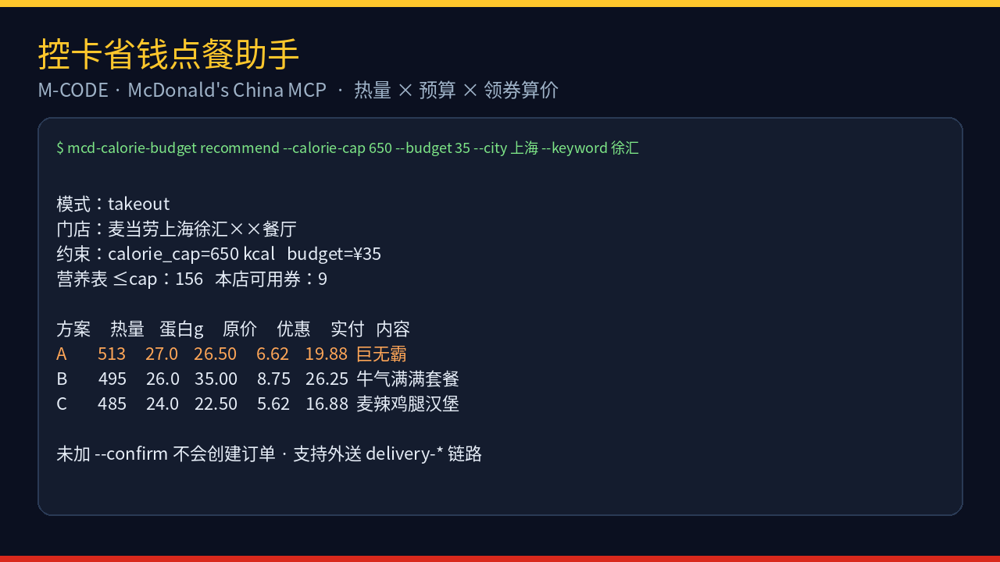

# 控卡省钱点餐助手

> 麦当劳程序员节创意开发大赛（M-CODE）参赛作品 · 非官方产品

基于麦当劳中国 MCP（`https://mcp.mcd.cn`）的 **可运行 CLI + Agent Skill**：在热量上限和/或预算内推荐可点餐品，自动领取「麦麦省」优惠券、算价，并在你确认后创建订单（返回支付链接，**不会静默下单**）。

<p align="center">
  
</p>

## 一句话

**热量卡死 + 预算卡死 → 领券算到手价 → 你点头才下单。**

## 目标用户

- 想控卡、又不想自己翻营养表的人
- 学生 / 打工人：热量和预算都卡死，还想吃麦当劳
- 用 Cursor / Codex / WorkBuddy / Cherry Studio 等 MCP 客户端的开发者

## 能做什么

1. 问清：热量上限（kcal）、可选金额上限（元）、城市/地址或外送地址、堂食/外带/外送
2. 拉营养数据，按热量筛餐品（默认优先汉堡/套餐，避免「低卡可乐」刷榜）
3. 查附近门店 **或** 外送地址可配送门店与可售菜单
4. 查券 / 一键领麦麦省 / 算到手价
5. 给出 **2～3 个方案**，按「贴近热量目标 → 实付更低 → 蛋白质密度」排序
6. **你确认后**才调用 `create-order`，返回支付链接

> 输出仅供参考，不构成医疗或营养建议。餐品、价格、库存以官方 MCP 实时结果为准。套餐若只能匹配到单品营养，会明确提示「可能偏低」。

## 仓库结构

```text
.
├── README.md
├── CONTEST_DECLARATION.md      # 参赛声明（内容不可改）
├── MCP_INTEGRATION.md          # MCP 接入与工具说明
├── workbuddy.md                # WorkBuddy 导出位（当前为诚实占位）
├── mcp-config.example.json
├── .env.example
├── pyproject.toml
├── docs/demo-recommend.png     # 实机 CLI 演示图（脱敏）
├── src/mcd_calorie_budget/     # 可运行 CLI（Streamable HTTP → mcp.mcd.cn）
├── skill/mcd-calorie-budget/SKILL.md
├── scripts/                    # 排序 / 冒烟脚本
├── fixtures/sample_candidates.json
└── examples/dialogue.md
```

## 前置条件

1. 前往 [open.mcd.cn/mcp](https://open.mcd.cn/mcp) 用**手机号**登录并申请 MCP Token  
2. 将 Token 放进环境变量或本地文件，**不要写进仓库**

```bash
export MCD_MCP_TOKEN="你的真实Token"
# 或：
# mkdir -p ~/.config/mcd && chmod 700 ~/.config/mcd
# umask 077; printf '%s' '你的Token' > ~/.config/mcd/mcp_token
```

## 可运行 CLI（推荐）

Python 3.10+，**零第三方依赖**（标准库即可）：

```bash
git clone https://github.com/cyAquarius/mcd-calorie-budget-skill.git
cd mcd-calorie-budget-skill
export MCD_MCP_TOKEN=...   # 或使用 ~/.config/mcd/mcp_token

# 安装入口（可选）
pip install -e .
# 或：PYTHONPATH=src python3 -m mcd_calorie_budget ...

# 1) 只读冒烟
mcd-calorie-budget smoke

# 2) 到店外带推荐
mcd-calorie-budget recommend \
  --calorie-cap 650 --budget 35 \
  --city 上海 --keyword 徐汇 --top 3

# 3) 外送：先看脱敏地址列表，再推荐
mcd-calorie-budget addresses
mcd-calorie-budget recommend \
  --mode delivery --address-id <完整addressId> \
  --calorie-cap 650 --budget 40 --top 3

# 4) 确认下单（真实订单 + 支付链接）
mcd-calorie-budget recommend ... --json > /tmp/plan.json
mcd-calorie-budget order --from-json /tmp/plan.json --pick A --confirm
```

### 实机冒烟摘要（脱敏）

上海徐汇附近、`calorie_cap=650`、`budget=35` 时曾得到：

| 方案 | 内容 | 热量 | 蛋白 | 原价 | 优惠 | 实付 |
|---|---|---:|---:|---:|---:|---:|
| A | 巨无霸 | 513 | 27 | 26.50 | 6.62 | 19.88 |
| B | 牛气满满套餐（培根蔬萃双层牛堡+玉米杯+无糖可乐） | 495 | 26 | 35.00 | 8.75 | 26.25 |
| C | 麦辣鸡腿汉堡 | 485 | 24 | 22.50 | 5.62 | 16.88 |

只读冒烟：`now-time-info` / `list-nutrition-foods`（160 条）/ `campaign-calendar` / `available-coupons` / `query-nearby-stores` / `delivery-query-addresses` 均可用。

## 安装 MCP（给 Agent / WorkBuddy）

将 [`mcp-config.example.json`](./mcp-config.example.json) 拷到客户端，并把 `YOUR_MCP_TOKEN` 换成真实 Token。官方说明：[M-China/mcd-mcp-server](https://github.com/M-China/mcd-mcp-server)。

### 安装本 Skill

```bash
mkdir -p .cursor/skills
cp -R skill/mcd-calorie-budget .cursor/skills/
```

对话里说「按控卡省钱点餐助手帮我点」，Agent 按 `SKILL.md` 走完整流程。

## 使用示例（Agent）

用户：

> 中午想吃麦当劳，热量别超 650 kcal，预算 30 块以内，上海徐汇附近，外带。

Agent：`now-time-info` → `list-nutrition-foods` → `query-nearby-stores` → `query-meals` → 领券算价 → 展示 2～3 方案 → 你确认后再 `create-order`。

外送时改走 `delivery-query-addresses` → `delivery-query-stores`（无地址才引导 `delivery-create-address`）。

更完整对话见 [`examples/dialogue.md`](./examples/dialogue.md)。

## 本地排序脚本（可选）

```bash
python3 scripts/rank_combos.py \
  --input fixtures/sample_candidates.json \
  --calorie-cap 650 --budget 30 --top 3
```

## 安全与合规

- 仓库内**无真实 Token**；只用环境变量 / `YOUR_MCP_TOKEN` 占位  
- **禁止**在未确认时调用 `create-order`（CLI 必须加 `--confirm`）  
- 外送地址列表默认脱敏展示电话与门牌  
- 本项目不代表麦当劳官方背书；商标归权利人所有  
- 详见 [`CONTEST_DECLARATION.md`](./CONTEST_DECLARATION.md)

## 许可证说明

参赛作品代码以学习与比赛交流为目的开源。使用麦当劳 MCP 须遵守麦当劳中国《使用条款》与 MCP 服务规则。

## 作者

GitHub: [cyAquarius](https://github.com/cyAquarius)

---

⭐ 如果觉得有用，欢迎 Star —— M-CODE 按公开 Star 排前 100。
